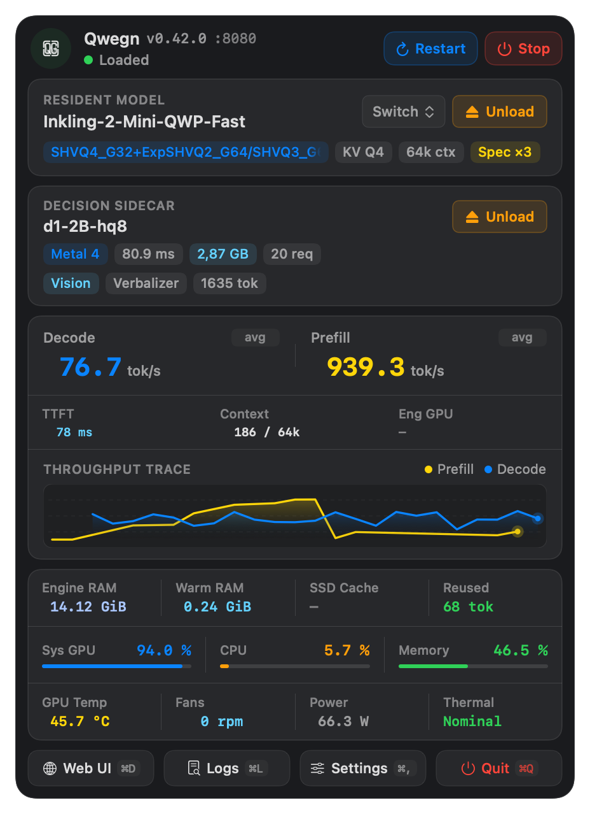
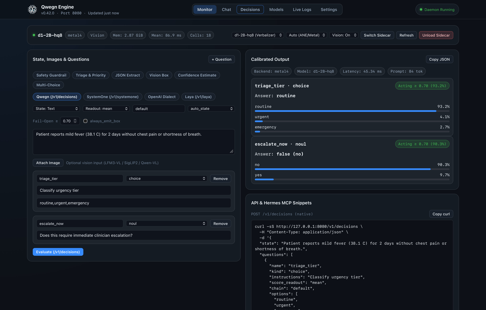

# Menu Bar App (`Qwegn.app`)

`Qwegn.app` (`qwg-menu`) places a live status and telemetry item in the macOS menu bar and manages the `qwg serve` lifecycle:

```bash
open /Applications/Qwegn.app          # installed via Qwegn-<version>-macos-arm64.pkg
open .build/release/Qwegn.app         # built from source via make build
```

- **Status Indicator**: Gray (`offline`), Amber (`idle / unloaded`), Cyan (`loading weights`), Green (`ready`), Blue (`prefilling`), Purple (`decoding`), Red (`error`).
- **Live Telemetry**: Displays customizable status item metrics (`Decode speed`, `Prefill speed`, `Engine memory`, `Context size`, optionally hiding speeds when idle) in the menu bar and opens a compact Control-Center popover showing **both** the primary LLM (`Engine RAM`, `Warm RAM`, `Reused`, `THROUGHPUT TRACE`) and an optional co-resident **Decision Sidecar** (`d1-2B-hq8`, backend, latency, resident UMA bytes, call/token counters, Vision/Verbalizer badges) running simultaneously in unified memory.
- **Settings (`⌘,`) — 7 Organized Tabs**:
  1. **General**: Server host/port, **Menu Bar Appearance** live preview (`Decode speed`, `Prefill speed`, `Engine memory`, `Context size`, and `"Only show speeds during active generation"`), launch-at-login, auto-start server, and keep-alive on quit.
  2. **Model**: Primary model pack picker, aliases, lazy vs eager loading, power-of-2 **Context Limit** slider (`64` to `1M` tokens with live UMA memory prediction), **KV Cache Mode** (`Q4` default / `Q8` / `F16`), live **Vision Tower (`loadVision`)** toggle without KV cache reset, and the 6 **Decision Sidecar** knobs (`decisionModelPackPath`, compute unit, vision loader, default score readout, truncation policy, `alwaysEmitBox`).
  3. **Sampling**: Temperature, Top-P, Top-K, repetition penalty, max generated tokens, seed, `<think>` mode, reasoning effort (`off` / `low` / `medium` / `high` / `xhigh` / `auto` sidecar routing), and default system prompt.
  4. **Speculative**: `Standard`, `Variational`, `DFlash 2` (`B=8`), and **`DSpine` (`B=16`, up to `15` drafts)** backends with automatic `config.json` drafter pack discovery (`~/.qwg/models`), relaxed margin `ε`, fidelity floor `τ`, quadratic prefix seeding, and adaptive entropy stop.
  5. **Performance**: Per-model **Memory Policy** (`Max Resident` vs `Safe`), **OS Reserve GiB**, scratch eviction, **Stream PLE N-gram Table from SSD (`streamNgrams`, `-27.3 GiB` GPU RAM)**, **MoE Expert Streaming** (`Resident Experts / Layer`, `MoE-Spec Verify Budget`, cross-token cache, event-pipelined cold staging, prefill span map), **Prefill Chunk Rows**, **Concurrent Sessions**, and **Latent Sparse Attention** (`Auto` default, `.qlsa` sidecar builder, `Ward-512` & `4,096 e-means`).
  6. **Memory & Cache**: One-click **Codebase Memory Pack (`.qwg/manifest.json`)** mount/unmount with automatic KV mode lock, plus Warm RAM and Cold SSD prefix cache limits.
  7. **Logging**: Log level (`debug`, `info`, `warn`, `error`) and quick Finder access to `~/.qwg/logs` and `~/.qwg/settings.json`.
- **Shortcuts**: `⌘D` opens the offline Web UI (`/ui`); `⌘,` opens Settings; `⌘L` opens the live server log viewer; `⌘R` restarts the `qwg` server; `⌘Q` cleanly stops the managed server and exits.

<table>
  <tr>
    <td width="38%" align="center"></td>
    <td width="62%"></td>
  </tr>
</table>

For the complete knob inventory, default-path rules, and copy-paste operational recipes, see [settings-reference.md](settings-reference.md), [lsa.md](lsa.md#3-menu-bar-app-qwg-menu-per-model-settings), and [lsa-codebase-memory-whitepaper.md](lsa-codebase-memory-whitepaper.md).
